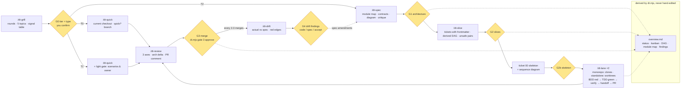

# dev-turbo workflow map (v0.2)



## Gates (your checkpoints)

| Gate | When | You approve | Recorded by |
|---|---|---|---|
| G0 | end of the grill | tier + type, from the facts and signal table | `dt.mjs gate <slug> 0 approve --tier --type` |
| G1 | after /dt-spec | module map, contracts as code, module diagram | `gate <slug> 1 approve` (standalone: opens the feature issue) |
| G2 | after /dt-slice | tickets, DAG, scenario titles, unsafe pairs | `gate <slug> 2 approve` (standalone: one issue per ticket) |
| G2b | ticket 00 | the walking skeleton, before any parallel work | review + merge of ticket 00 |
| G3 | per ticket / per quick PR | merge, after /dt-review | `gate <slug> 3 approve --ticket <id>` (standalone: removes the worktree) |
| G4 | every 2-3 merges and at the end | each drift finding: code / spec / accept | `gate <slug> 4 approve --note` |
| T1 light gate | before code in /dt-quick | scenario titles + owning module | chat only |

Every gate card has the same shape: what you approve in ≤ 10 lines, the relevant diagram, the 3 least-sure decisions, up to 5 "look yourself" pointers, and the approve/change question. Cards and decisions are appended to `gates.md`.

## Two modalities

| | monorepo (`csscompany-enterprise/monorepo`) | standalone (everything else) |
|---|---|---|
| lanes | the two clones listed in config.json | worktrees `../<repo>.lane-<id>`, created by `dt.mjs next` |
| feature docs | `~/.pi/agent/dt/features/<org>/<repo>/<slug>/`, shared by both clones, not committed | `docs/features/<slug>/`, committed |
| GitHub | no issues; draft PR per ticket | feature issue (spec) + issue per ticket + ready PR per ticket |
| review | local, posted as a PR comment | same |

## Feature folder

```
<features dir>/<slug>/
  feature.json      tier, type, modality, feature issue
  spec.md           sections 1-11, module diagram in section 4
  tickets/NN-*.md   frontmatter: id, title, kind, blocked_by, touches, verify, unsafe_with, issue
  handoff/NN.md     one per ticket, written by the lane
  gates.md          every gate card and decision, dated
  arch-<date>.md    drift reviews (actual diagram, scores, findings)
  overview.md       generated: status, kanban, DAG, module map, open findings
```

Status is derived from git: branch exists → in_progress; handoff exists → review; G3 recorded → done.
