# dev-turbo workflow map (v0.3)

```mermaid
flowchart LR
  G["/dt-grill<br/>rounds · 5 topics · signal table"] --> G0{"Scope<br/>/dt-approve scope"}
  G0 -->|T0| Q["/dt-quick<br/>current checkout · quick/* branch"]
  G0 -->|T1| Q1["/dt-quick<br/>+ light gate: scenarios & owner"]
  G0 -->|T2| S["/dt-spec<br/>module map · contracts · diagram · critique"]
  S --> G1{"Architecture<br/>/dt-approve architecture"}
  G1 --> SL["/dt-slice<br/>tickets with frontmatter · derived DAG · unsafe pairs"]
  SL --> G2{"Slices<br/>/dt-approve slices"}
  G2 -->|"initial plan"| T0["ticket 00 skeleton<br/>+ sequence diagram"]
  G2 -->|"existing plan; 00 accepted"| L
  T0 --> SkeletonAcceptance{"Skeleton acceptance<br/>/dt-approve ticket 00"}
  SkeletonAcceptance --> L["/dt-lane ×2<br/>monorepo: clones · standalone: worktrees<br/>BDD red → TDD green → verify → PR"]
  Q & Q1 & L --> R["/dt-review<br/>3 axes · arch delta · PR comment"]
  R -->|"findings: fix and re-review"| R
  R --> M["human merges PRs<br/>/dt-final-check verifies acceptance · saves evidence"]
  M --> G3{"Ticket acceptance<br/>/dt-approve ticket"}
  G3 -->|"T2: next ready ticket"| L
  G3 -->|"every 2-3 merges and at the end"| D["/dt-drift<br/>actual vs spec · red edges"]
  D --> G4{"Architecture drift<br/>/dt-approve drift"}
  AM["/dt-amend description<br/>questions · chat recommendation"] -->|"spec/design change"| S
  AM -->|"ticket-plan change only"| SL
  G4 --> DA["/dt-drift apply<br/>apply approved decisions"]
  DA -->|"spec or scope amendments"| SL
  DA -->|"unchanged plan; more work"| L
  DA -->|"all accepted; final drift resolved"| Done["/dt-status<br/>complete"]
  subgraph memory["the only memory between sessions"]
    O["feature folder<br/>feature.json · spec.md · tickets/ · progress.json"]
  end
  S & SL & L & R & D -.->|"dt.mjs saves state"| O
  O -.->|"/dt-resume"| X["any new session"]
  classDef gate fill:#fde68a,stroke:#b45309
  class G0,G1,G2,SkeletonAcceptance,G3,G4 gate
```



## Sessions are disposable

The grill saves a Scope proposal. `/dt-approve scope` asks you to confirm the slug, records Scope approval and selects that project. Following slash commands omit the slug: `/dt-spec`, `/dt-slice`, `/dt-lane next`, `/dt-review <id>`, `/dt-drift`, `/dt-status`. The footer shows the selection above the model name. Selection is stored in the Pi session and scoped to the repo/feature directory; reopening, reloading or forking restores it, and session-tree navigation follows the selection on that branch. A new session starts unselected; `/dt-resume [slug]` selects an existing feature. Starting a new grill clears the old selection. Missing selections fail before any workflow prompt reaches the model. The underlying dt.mjs CLI still requires explicit slugs.

The grill, `/dt-amend` clarification rounds and `/dt-spec` may rely on the conversation. `/dt-amend` writes nothing: a fresh session must ask for the intended change if it is not in context. Design proposals go into spec.md and slice proposals into ticket files through their respective commands; other workflow outcomes use saved state. In a new session, `/dt-resume` lists the repository's features, refreshes PR and issue states, posts a short brief, and can put the next workflow command into the editor without running it. Context stays small: the brief, then only the ticket, spec sections and code the next step needs.

## Gates (your checkpoints)

| Approval | Internal ID | User command |
|---|---|---|
| Scope | G0 | `/dt-approve scope` confirms the proposal and selects the project. |
| Architecture | G1 | `/dt-approve architecture` accepts modules and contracts. |
| Slices | G2 | `/dt-approve slices` accepts the ticket plan (or T1 scenario plan). |
| Ticket acceptance | G3 | `/dt-approve ticket <id>` after merge and verified acceptance; quick tasks omit the ID. |
| Architecture drift | G4 | `/dt-approve drift` chooses each finding; `/dt-drift apply` applies the saved decisions. |

Ticket 00 is the skeleton. Its acceptance is not an extra gate. Only `/dt-approve` records human approval; discussion revises proposals. No approval command merges a PR or starts implementation.

Initial-planning and review gate cards have the same general shape: what you approve in ≤ 10 lines, the relevant diagram, the 3 least-sure decisions, up to 5 "look yourself" pointers, and the exact next `/dt-approve` command; questions and changes stay in discussion. The card itself stays in chat; `progress.json` keeps the gate's state (`pending`, `approved`, `changes`) and a one-line note, and design decisions go into `spec.md`.

### T2 implementation loop

After 00 acceptance: `/dt-lane next` → `/dt-review <id>` (fix and repeat review) → human merge → `/dt-final-check <id>` (missing acceptance evidence only) → `/dt-approve ticket <id>` → next ready ticket. At most two tickets are in flight. Every 2–3 merges and at the end, take `/dt-drift` → `/dt-approve drift` → `/dt-drift apply`. Changed spec/scopes return through slice alignment and Slices approval; unchanged plans return to the next ready ticket. All tickets accepted plus resolved final drift ends the loop. See the compact diagram and command table in the README's Flow section, also displayed by `/dt-help`.

### Deliberate amendments

`/dt-amend <description>` keeps the selected T2 project, asks focused questions, then explains whether and how the spec and plan/tickets/slices need changing. It creates no artifact and changes no gates, progress, implementation or acceptance. Once clarified, it suggests `/dt-spec` for design changes or `/dt-slice` for plan-only changes and stops. The downstream command uses the chat; in a fresh session, the user restates the intent. Existing named approval gates decide downstream proposals. This is separate from drift and does not create a new Scope gate.

### Re-slicing an existing plan

After approved drift amendments, `/dt-slice` reviews alignment rather than proposing the whole plan again. Its card shows the current spec path and amendment summary, preserved done/merged work, affected tickets with status and reasons, and dependency/parallelism and acceptance deltas. No full ticket table, DAG or unchanged scenario inventory unless requested. Merged 00 awaiting recorded acceptance is not awaiting implementation. Documentation-only clarification does not itself reopen Ticket acceptance; substantive scope/acceptance changes do. The prompt defines this delta-card exception to the general gate-card shape above.

## Two modalities

| | monorepo (`csscompany-enterprise/monorepo`) | standalone (everything else) |
|---|---|---|
| lanes | the two clones listed in config.json | worktrees `../<repo>.lane-<id>`, created by `dt.mjs next` |
| feature docs | `~/.pi/agent/dt/features/<org>/<repo>/<slug>/`, shared by both clones, auto-committed to a local git repo | `docs/features/<slug>/` in the main checkout, committed |
| work items | tickets only: no issues in the monorepo (Jira keys can be recorded with `--issue`) | tickets + feature issue + issue per ticket |
| GitHub | draft PR per ticket | ready PR per ticket |
| review | local, posted as a PR comment | same |

## PR bodies

Use the format in [AGENTS.md](AGENTS.md):
- A few short change bullets under `## Description`. Simple words, no filler or fixed bullet count.
- A sequencing line only when named PRs really must merge first.
- `## Testing` starts with `unit tests + staging tests`, followed by one suggested staging check.
- Actual curl/browser checks may be simple bullets. Test implementation and unfinished work stay out of the description.
- Save pending checks in progress.json. Do not overwrite a description the user has edited.

## Feature folder

```
<features dir>/<slug>/
  feature.json      identity: tier, type, modality
  spec.md           the approved design; approved amendments edit it in place
  tickets/NN-*.md   frontmatter: id, title, kind, blocked_by, touches, verify, unsafe_with
  progress.json     current state, written only by dt.mjs
```

`progress.json` holds the current state, not history: gate states, the feature's next step, blockers and todo, and per ticket its status, lane, branch, next step, todo, blockers, a one-line verification (with its commit), PRs and issues with their last observed state. Each update replaces the old values; old states live in git history. Ticket status moves with the commands: `next` → in_progress, `pr` → review, `gate 3 approve` → done; `progress --status` corrects it.
