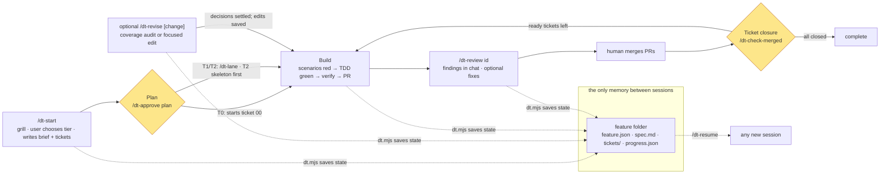

# dev-turbo workflow map (v0.4)

T0 implements and verifies on the current branch of the current checkout, never creating a branch and leaving code uncommitted unless the user explicitly requests a commit or PR. The commit, push, PR and merge flow below applies to T1/T2; T0 reports local results without merge-based closure.



## Sessions are disposable

The grill gives a short task summary and asks you to choose T0, T1 or T2 without guessing or recommending a tier. Only after your explicit choice does it write the plan and save a plan proposal; the chat choice approves nothing. `/dt-approve plan` asks you to confirm the slug, creates the project, records approval and selects it. For T0, the same confirmation starts ticket 00 on the current branch after safety checks; warnings require a separate Start anyway decision. A blocked start keeps the plan approved, and `/dt-lane 00` retries or resumes with normal ticket confirmation. T1/T2 still need `/dt-lane`. Following slash commands omit the slug: `/dt-lane`, `/dt-review <id>`, `/dt-check-merged`, `/dt-revise`, `/dt-status`. The footer shows the selection above the model name. Selection is stored in the Pi session and scoped to the repo/feature directory; reopening, reloading or forking restores it. A new session starts unselected; `/dt-resume [slug]` selects an existing feature. Starting a new grill clears the old selection. The underlying dt.mjs CLI still requires explicit slugs.

Everything after the grill reads the feature folder, so any step can continue in a fresh session. `/dt-revise` writes its outcome straight into the brief and tickets; nothing depends on chat history.

## The plan

The plan reflects the grill, not new design. T2 gets a one-to-two page brief (`spec.md`: outcome, goals and non-goals, behavior and constraints with reasons, the module map, scale and risks, acceptance criteria, follow-ups) and a handful of outcome-level tickets. The spec says what and why; the shared module map lives in `spec.md`, defining exact `touches` keys, concrete code/artifact paths, responsibilities and module dependencies. Tickets say how: slices, ticket/lane ownership, ticket dependencies, implementation approach and landing order. Ticket 00 builds the mapped interfaces as code rather than duplicating the map. T0 gets one ticket and T1 gets 1-5 tickets, neither with a brief; T1 tickets name their modules directly. Tickets carry frontmatter for dependencies and parallel safety, then Outcome, Scope, Example, Out of scope and Done when. No contracts on paper, change tables or Gherkin: T2 ticket 00 writes the interfaces as code and they are reviewed in its PR; each lane writes scenarios from its ticket's outcome.

## Approvals

| Approval | Internal ID | User command |
|---|---|---|
| Initial plan | G0 (new project); G2 stores its usable approval | `/dt-approve plan` |
| Ticket closure | G3 | `/dt-check-merged` checks every open ticket's PRs live on GitHub and closes each ticket whose PRs are all merged. |

Only `/dt-approve plan` approves an initial plan, and only `/dt-check-merged` closes tickets after you merge. Later `/dt-revise` edits keep that approval intact after any unsettled decisions are answered in chat; they do not require a second formal approval. Legacy pending gates still follow their saved confirmation path and are not silently cleared. New T0 approvals also start ticket 00; T1/T2 and legacy revision approvals do not start implementation. No approval merges a PR. Ticket closure does not claim staging or production acceptance.

Code review is not a gate: `/dt-review` reads code, suggests actionable improvements in chat and offers to fix user-selected items. It never posts PR reviews or comments. Re-review after fixes is optional.

## Force closure

`/dt-close <ticket> <reason>` immediately marks the specified ticket (local ID, e.g. `00`) in the selected project done when it is in progress or review, releases its claim and records the reason as forced closure. No merge or test checks run; unfinished work and verification are retained, along with files, branches, worktrees, PRs and issues. Dependent tickets may now start, but other agents are not stopped. Works from any checkout, not just the ticket’s lane. A missing ticket or reason, invalid or unknown ticket ID, inactive ticket or running task leaves progress unchanged.

## Revising the plan

Agents maintain the spec and editable tickets directly during normal work. No `/dt-revise` invocation is required. Optional `/dt-revise <change>` handles a deliberate change and edits only affected files. Implementation-only revisions that do not affect the module map leave the spec untouched. Update or backfill module names, paths, responsibilities and module dependencies in the spec without editing completed tickets. `/dt-revise` without arguments audits spec/ticket coverage in both directions: each requirement needs coverage or an explicit exclusion, and each ticket outcome needs a settled purpose in the spec. It checks contradictions, module definitions and dependencies, fixes clear documentation mismatches and asks only about unresolved decisions. Code is consulted for factual ambiguity or an explicitly requested code-alignment audit, not by default. Todo tickets are edited freely; in-flight tickets only get clarified wording unless their scope must change (then a review handover is recorded); done and merged tickets never change, and extra work becomes a new ticket.

Revisions do not create a new approval gate, including changes to building blocks, scope or ready-ticket dependencies. Ask about genuinely unsettled choices in chat and wait for the answer; explicit requested changes need no duplicate confirmation. Save the edits and next step under the original plan approval. In-flight work continues with its required scope-change handovers, and lane/checkout conflicts are shown as warnings and can be explicitly overridden at ticket start.

## Investigation before implementation

Create a bounded spike when feasibility, an implementation approach, external behavior or a performance risk needs an experiment. Use normal tickets and AFK/HITL ownership, with an Investigation section naming the question, options, experiment, time or effort limit and findings document path. The deliverable is reviewed evidence and a recommendation, not production implementation; negative or inconclusive findings are valid when the acceptance checks are met. Findings follow normal PR review and merge closure.

Dependent implementation tickets use `blocked_by` and leave the unresolved approach open. A prerequisite spike may precede ticket 00 without depending on it; 00 then depends on the spike. Other spikes depend on 00 when they need the skeleton. After review, the agent settles the approach in affected editable tickets directly, asking about unresolved choices; the spec changes only when requirements or the shared module map change. T0 stays one ticket; ask the user before moving to a T1 or T2 project for separate spike and implementation tickets.

## Lanes, issues and PRs

| | |
|---|---|
| T1/T2 lanes | worktrees `../<repo>.lane-<id>`, created by `dt.mjs next` from the main checkout |
| T0 | the current branch, with no new branch or commits |
| feature docs | `docs/features/<slug>/` in the main checkout; commit T1/T2 tickets before starting lanes |
| work items | tickets + GitHub issue per ticket (T1/T2), plus a feature issue (T2) |
| GitHub | ready PR per ticket |

Ticket starts report policy conflicts as warnings. Selecting Start anyway, `/dt-lane <id> override` or CLI `next --override` explicitly bypasses dependencies, unsafe/shared-module constraints, saved blockers, plan gates, ownership/checkout rules and completed-work guards. Override is not plan approval and does not stop agents or discard files; invalid data, the progress lock and native Git/API failures still need valid inputs or repair. Takeover fences the displaced owner, and other active claims are retained when sharing a checkout. Reopened work requires a fresh PR before merge-based closure.

Ticket progress stores no historical lane assignment. `claim.checkout` protects active work; an optional `worktree` path persists for resume and cleanup.

## Remaining slices

`/dt-slice-plan` reads the selected project and lists remaining ticket IDs in parallel batches. `/dt-slice-plan all` (ticket IDs only, without Git branches) rebuilds batches from the beginning using the current tickets and dependencies, including completed tickets, and labels each slice `closed` (all tickets done or fully merged), `in-flight` (any open ticket ready, in progress or under review), or `blocked` (all remaining tickets blocked). Reopened tickets remain open; closed tickets alone do not make a mixed slice active. It excludes done tickets and tickets whose saved PRs are all merged (unless reopened). In-progress and review tickets remain. Dependencies must finish in earlier batches; either direction of `unsafe_with` keeps tickets in separate batches. Shared `touches` do not split the display plan, but shared-module start guards still apply when actually starting work. Numeric ID order makes the greedy batches deterministic, without imposing a lane limit. This is a read-only projection, not permission to start work; missing dependencies and cycles are reported explicitly.

## Staging tests

`/dt-staging-test [id]` claims the ticket, writes a script and runbook under `<feature>/staging-tests/<id>/`, and stops for your review. It runs only the confirmed script version. A pass replaces the PR's Testing bullets with the checks that passed; a failure is fixed and goes back to review. It prefers an isolated preview or sandbox environment when the project offers one. Releases, DDL and production access stay with you.

## PR bodies

Use the format in [AGENTS.md](AGENTS.md):
- One short line per change under `## Description`, in everyday product words: what the user sees, and what stays the same. See "Writing descriptions" in AGENTS.md.
- A sequencing line only when named PRs really must merge first.
- `## Testing` starts with `unit tests + staging tests`, followed by one suggested staging check, or by the checks that passed after `/dt-staging-test`.
- Actual curl/browser checks may be simple bullets. Test implementation and unfinished work stay out of the description.
- Save pending checks in progress.json. Do not overwrite a description the user has edited.

## Feature folder

```
<features dir>/<slug>/
  feature.json      identity: tier, type
  spec.md           T2: what and why + module map; independent of ticket breakdown
  tickets/NN-*.md   how: work breakdown, ticket/lane ownership, dependencies and delivery checks
  progress.json     current state, written only by dt.mjs
```

`progress.json` holds the current state, not history: plan state, the feature's next step, blockers and todo, and per ticket its status, branch, next step, todo, blockers, a one-line verification (with its commit), PRs and issues with their last observed state. Each update replaces the old values; old states live in git history. Ticket status moves with the commands: `next` → in_progress, `pr` → review, `gate 3 approve` → done; `progress --status` corrects it.
